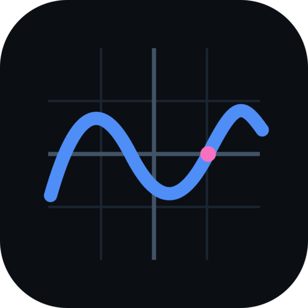
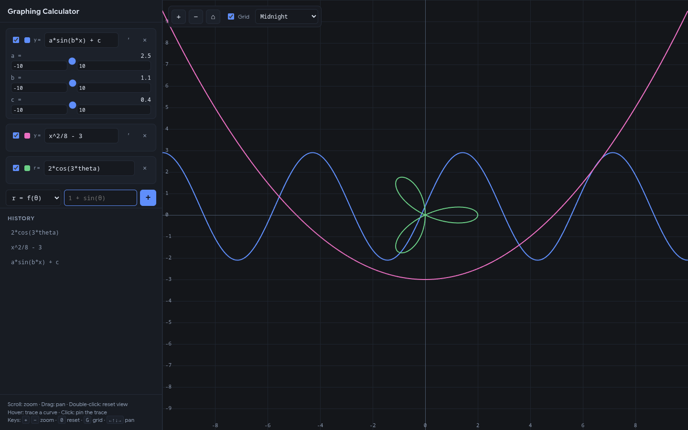
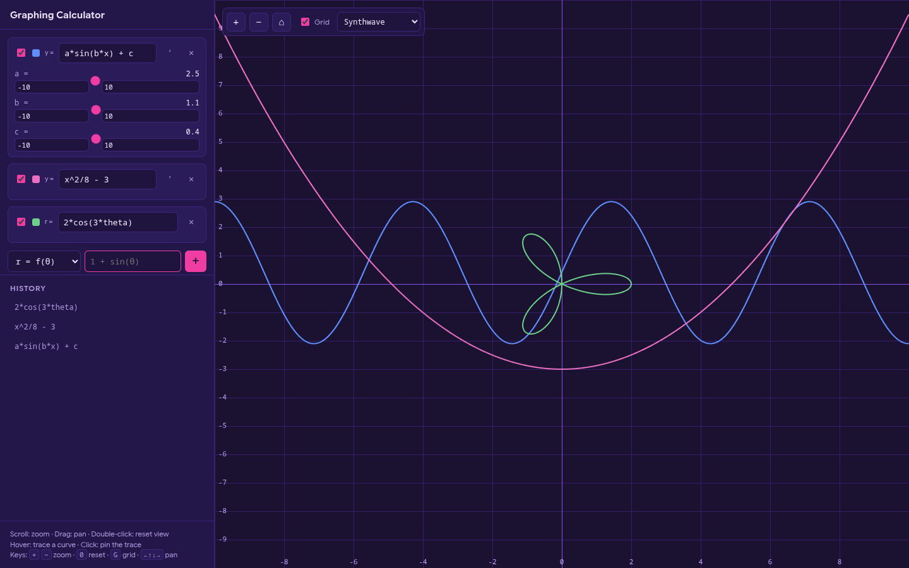
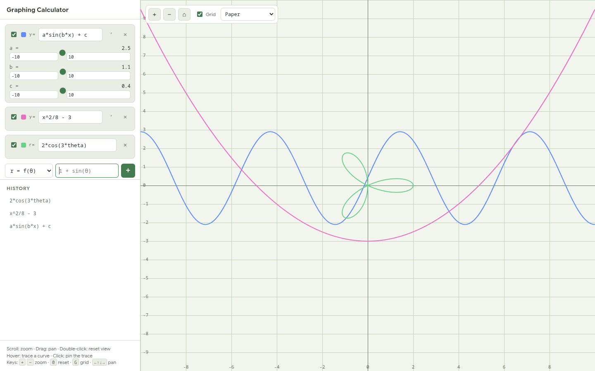

<div align="center">



<h1>Graphing Calculator</h1>

**Plot beautiful math — instantly.**

A fast, dependency-free graphing calculator for the web and desktop.
calc.nodecapture.co.uk

<sub>Cartesian · Polar · Parametric · Automatic sliders · Symbolic derivatives · Live tracing · Seven themes</sub>

<br />
<br />

[](https://github.com/Spoolable/graphing-calculator/actions/workflows/build-desktop.yml)


<br />

[Quick start](#quick-start) ·
[Downloads](#downloads) ·
[Usage](#usage) ·
[How it works](#how-it-works) ·
[Releases](https://github.com/Spoolable/graphing-calculator/releases)

<br />



<sub><b>Midnight</b> — three graph types, automatic sliders, and a live trace readout on a single canvas.</sub>

</div>

## Highlights

| | |
| :--- | :--- |
| **Three graph types**<br />Cartesian `y = f(x)`, polar `r = f(θ)`, and parametric `(x(t), y(t))` with an editable t-range. | **Automatic sliders**<br />Every unknown name becomes a slider — `a*sin(b*x + c)` gives you `a`, `b`, and `c` with editable min/max ranges. |
| **Symbolic derivatives**<br />Exact derivative curves via AST differentiation, drawn dashed, with the slope `y'` shown in the trace readout. | **Live tracing**<br />Hover to snap to any curve and read its coordinates; click to pin the reading while you explore. |
| **Seven themes**<br />Midnight, OLED Black, Solarized Dark, Synthwave, Forest, Graphite, and Paper — the grid, axes, and palette all adapt. | **Clean rendering**<br />At least one sample per pixel column with discontinuity detection, so asymptotes are never bridged. HiDPI-aware. |
| **Zero runtime dependencies**<br />A hand-written lexer → parser → compiler pipeline, with user input validated and compiled — never `eval`'d raw. | **Browser and desktop**<br />The same UI runs in any modern browser or as a standalone Windows `.exe` / Linux AppImage. |

## Screenshots

| Synthwave | Paper |
| :---: | :---: |
|  |  |

## Quick start

### Run in the browser

```bash
git clone https://github.com/Spoolable/graphing-calculator.git
cd graphing-calculator
npm install
npm run dev        # → http://localhost:5173
```

### Run as a desktop app

```bash
npm run app        # build the web assets and launch the Electron window
```

## Downloads

Prebuilt binaries live on the [**latest release**](https://github.com/Spoolable/graphing-calculator/releases/latest).

| Platform | Download | Notes |
| :--- | :--- | :--- |
| **Windows x64** | [Portable `.exe`](https://github.com/Spoolable/graphing-calculator/releases/latest/download/Graphing-Calculator-1.1.0-x64.exe) | Single file, nothing to install |
| **Linux x64** | [`.AppImage`](https://github.com/Spoolable/graphing-calculator/releases/latest/download/Graphing-Calculator-1.1.0-x86_64.AppImage) | `chmod +x` and run |

The binaries are unsigned, so Windows SmartScreen may warn on first launch — choose **More info → Run anyway**.

## Usage

### Adding expressions

1. Pick a graph type: `y = f(x)`, `r = f(θ)`, or `(x(t), y(t))`.
2. Type the expression — **without** `=` — and press **Enter** or **+**.
3. Each expression gets its own color, visibility checkbox, derivative toggle (Cartesian), and delete button.

### Syntax

| Category | Supported |
| :--- | :--- |
| **Operators** | `+` `-` `*` `/` `^`, parentheses, implicit multiplication (`2x`, `x(x+1)`) |
| **Functions** | `sin cos tan asin acos atan sinh cosh tanh asinh acosh atanh ln log log2 log10 sqrt cbrt exp abs floor ceil round sign min max hypot mod atan2` |
| **Constants** | `pi` / `π`, `e`, `tau` / `τ` |
| **Parameters** | `x` (Cartesian), `θ` / `theta` / `t` (polar), `t` (parametric) |
| **Shorthand** | `×` → `*`, `÷` → `/`, `−` → `-` |

### Sliders

Any name that isn't the graph's parameter becomes a slider — for example
`a*sin(b*x + c)` produces sliders for `a`, `b`, and `c`. Drag to explore, or edit
the min/max boxes to re-range a slider.

### Derivatives

Press **′** on any Cartesian expression to plot its derivative as a dashed curve
in the same color. The trace readout also shows the slope at the traced point.

### Themes

Pick a theme from the toolbar — the entire UI, grid, axes, and curve palette switch
instantly, and your choice is remembered.

| Theme | Style |
| :--- | :--- |
| Midnight | The default deep-blue dark theme |
| OLED Black | True-black background with neon curves — great on OLED screens |
| Solarized Dark | The classic Ethan Schoonover palette |
| Synthwave | Retrowave purple with hot-pink accents |
| Forest | Deep green with bright, nature-toned curves |
| Graphite | Clean neutral light theme |
| Paper | Light graph-paper look with green grid lines |

### Navigation

| Action | How |
| :--- | :--- |
| **Zoom** | Scroll wheel (toward cursor), `+` / `−` keys, or toolbar buttons |
| **Pan** | Drag the graph, or arrow keys (`Shift` for fine steps) |
| **Reset view** | Double-click, `0` key, or the ⌂ button |
| **Trace** | Hover near a curve; click to pin, click again to release |
| **Grid** | `G` key or the Grid checkbox |

## How it works

```
src/
├── math/     lexer → parser → AST → validated JS closure; symbolic differentiation
├── graph/    viewport transforms, 1–2–5 tick generation, adaptive sampling, renderer
├── theme/    theme definitions: CSS variables, canvas colors, and curve palettes
├── state/    observable app store + localStorage persistence
└── ui/       sidebar, trace overlay, pointer and keyboard interactions
electron/     desktop shell (Chromium window, local file loading)
build/        app icons (SVG, PNG, ICO)
docs/         README screenshots and icon
```

Expressions are parsed into an AST — user input is never `eval`'d raw. The AST is
validated (function names, arity, unknown variables) and compiled into a tight
JavaScript closure for fast evaluation. Rendering samples at least once per pixel
column, drawing a vertical span per column so steep sections stay solid, and breaks
polylines at non-finite values and discontinuity jumps so asymptotes are not bridged.
The viewport, expressions, sliders, and theme persist in `localStorage`.

## Testing

```bash
npm test           # 63 unit tests
npm run test:watch # re-run on change
```

The suite covers parsing and compilation, symbolic derivatives, tick formatting,
viewport math, sampling and discontinuity behavior, and theme definitions.

## Tech

- **TypeScript** (strict) and **Canvas 2D** — zero UI or graphing dependencies
- **Vite 8** — dev server and bundler
- **Electron 45** + **electron-builder** — Windows portable `.exe` and Linux AppImage
- **Vitest 5** — unit tests

## Contributing

Issues and pull requests are welcome. If this project is useful to you, a ⭐ helps
more people find it.

---

<div align="center">
<sub>Built by <a href="https://github.com/Spoolable">Luis Moody</a> · <a href="https://github.com/Spoolable/graphing-calculator">GitHub</a> · <a href="https://github.com/Spoolable/graphing-calculator/releases">Releases</a></sub>
</div>
